<div align="center">

# Financer SaaS

**CRM + gestão financeira multi-empresa, com portal do cliente, importação em massa e lançamentos pelo Telegram.**


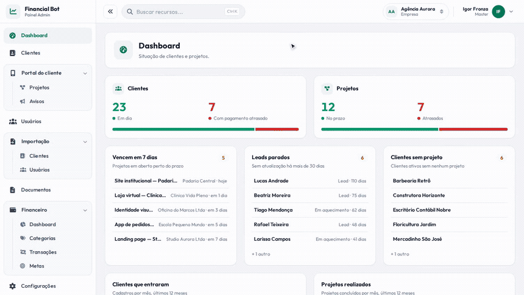

</div>

> [!NOTE]
> **Este é um modelo de projeto financeiro, ainda sem nicho definido.** Ele nasceu como uma base genérica de SaaS
> (empresas, usuários, clientes, projetos, financeiro) para ser **verticalizada** em um nicho depois: agência,
> clínica, prestador de serviços, assessoria... Por isso as telas e os textos são gerais, e os dados das demonstrações
> abaixo são fictícios. O foco aqui é a **arquitetura e a qualidade da base**, não um mercado específico.

## ✨ O que ele faz

| | Módulo | Em uma frase |
|---|---|---|
| 🏢 | **Multi-empresa (SaaS)** | Cada empresa só enxerga os próprios dados; licença com validade e troca de empresa para o administrador. |
| 📊 | **Dashboard** | Clientes e projetos em dia ou atrasados, listas do que precisa de atenção e gráficos dos últimos 12 meses. |
| 👥 | **Clientes e funil** | Lead → em aquecimento → cliente → cancelado, com formulário público de captação por empresa. |
| 🗂️ | **Projetos e portal do cliente** | Etapas e progresso; o cliente acompanha tudo pelo celular, entrando com um código enviado por e-mail. |
| 💰 | **Financeiro** | Transações, categorias, metas (guardar e limitar gastos) e um dashboard financeiro com filtros. |
| 📥 | **Importação em massa** | Planilha Excel/CSV → relaciona colunas → revisa e corrige no grid → importa em fila → baixa os erros. |
| 📄 | **Documentos** | Contratos e propostas com variáveis (`{{Cliente.name}}`), emitidos em PDF já preenchido. |
| 💳 | **Mercado Pago** | Importa vendas, tarifas e estornos automaticamente para o financeiro. |
| 🤖 | **Bot do Telegram** | Lança receitas e despesas e consulta o balancete direto no chat. |
| 🔐 | **Permissões e auditoria** | Permissão por ação em cada usuário e histórico de quem alterou o quê. |

## 🎬 Veja funcionando

### Importação de clientes em 5 passos
Anexar a planilha, relacionar as colunas (o que o sistema reconhece sozinho já vem preenchido), revisar e **corrigir
direto no grid**, confirmar e acompanhar o processamento em fila. Quem já existe é atualizado, e o sistema avisa
antes. O que falhar vira um CSV com a coluna **Erro** para corrigir e reenviar.

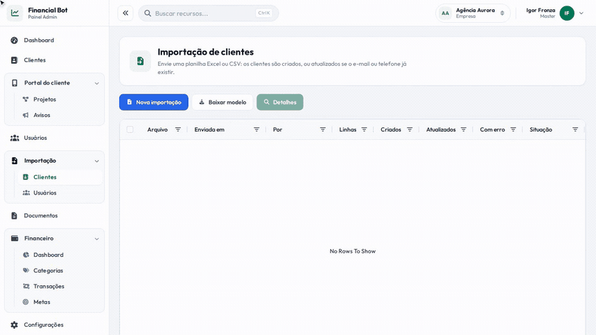

### Grid com busca, filtros, colunas e exportação
Todas as listas usam o mesmo componente: busca, filtros, escolha das colunas visíveis e exportação para Excel/CSV
na ordem e com os títulos que estão na tela.

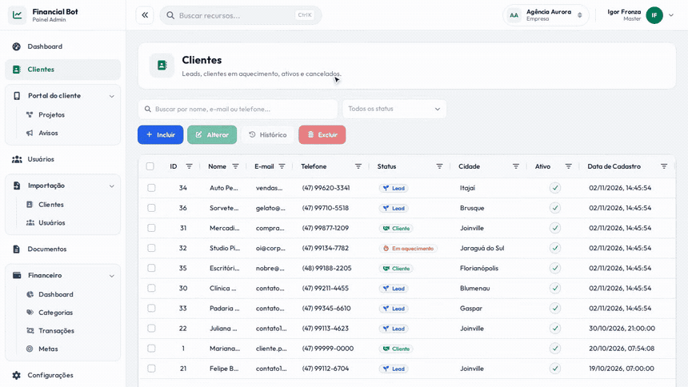

### Dashboard financeiro
Período, categorias, origem e status filtram todos os números e gráficos ao mesmo tempo.

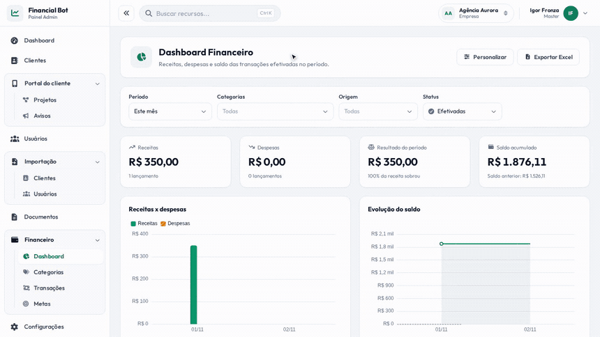

## 🖼️ Telas

<table>
  <tr>
    <td width="50%">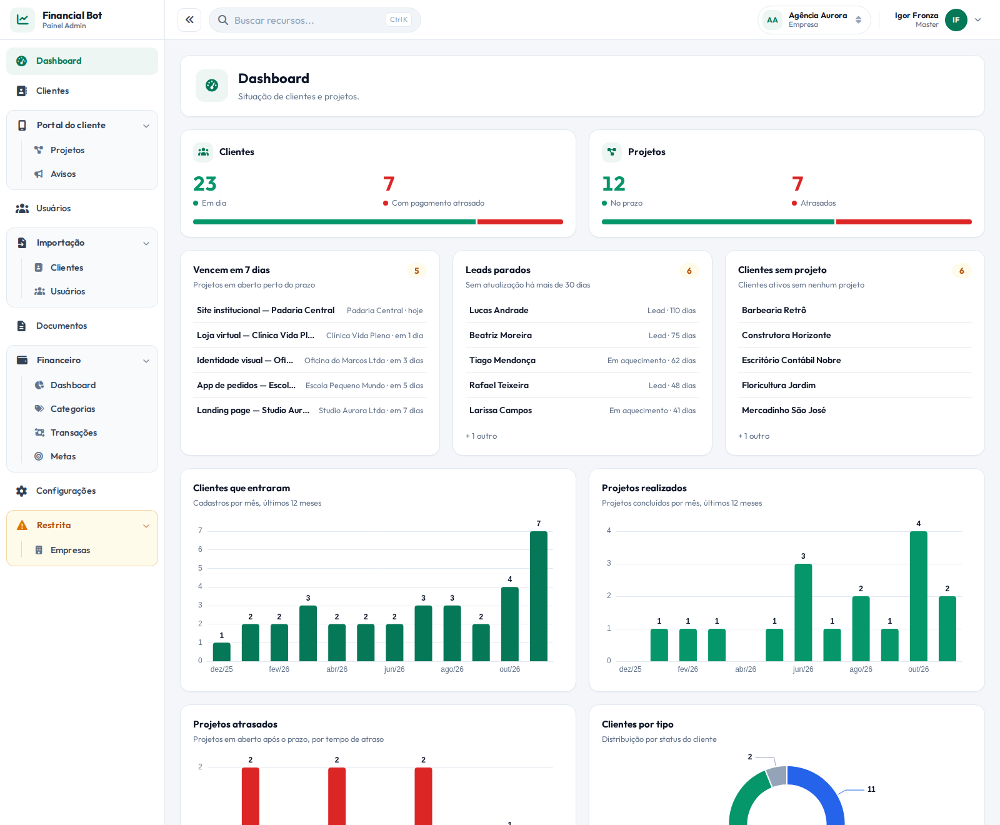<br><sub><b>Dashboard</b>: situação de clientes e projetos</sub></td>
    <td width="50%">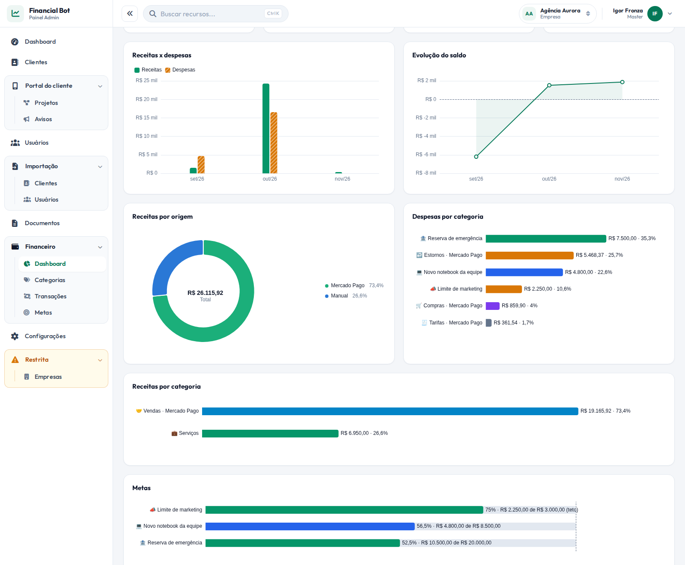<br><sub><b>Financeiro</b>: receitas, despesas, saldo e metas</sub></td>
  </tr>
  <tr>
    <td>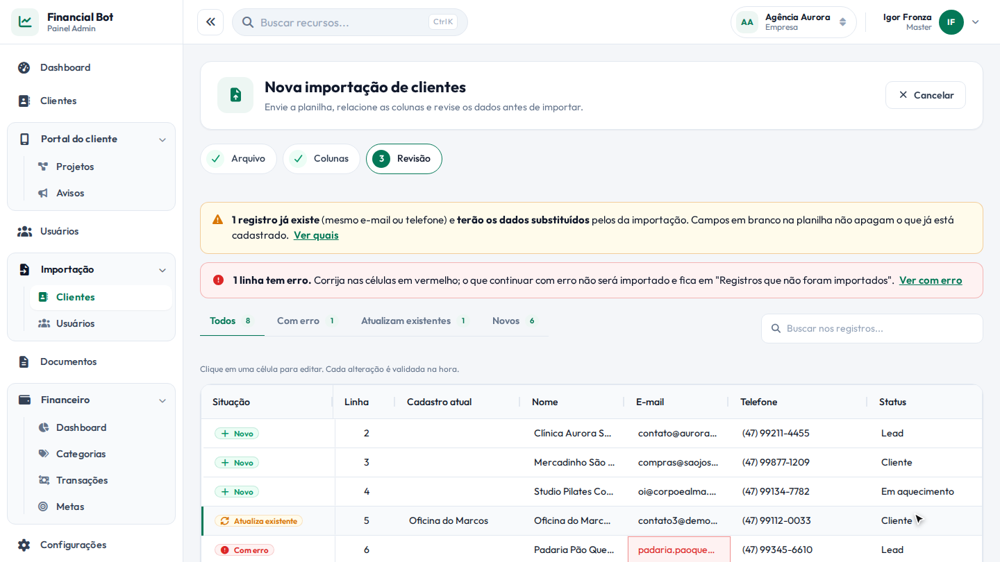<br><sub><b>Importação</b>: revisão com validação linha a linha</sub></td>
    <td>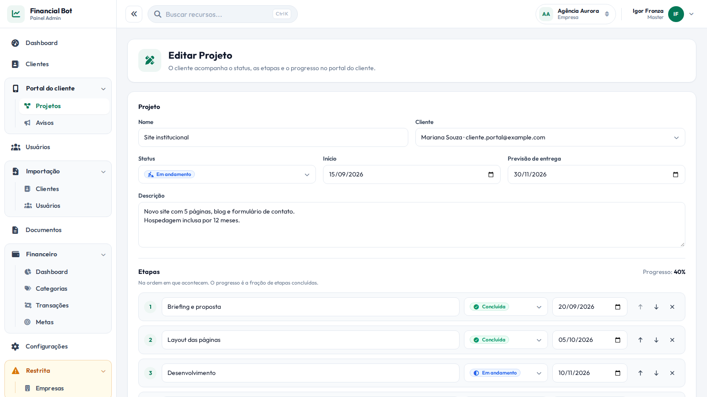<br><sub><b>Projetos</b>: etapas e progresso que o cliente vê no portal</sub></td>
  </tr>
  <tr>
    <td>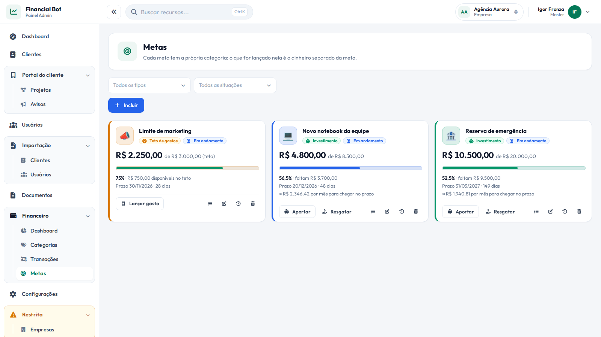<br><sub><b>Metas</b>: guardar dinheiro ou limitar gastos</sub></td>
    <td>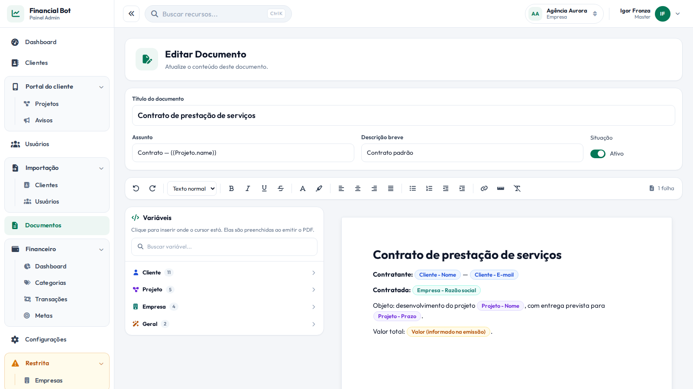<br><sub><b>Documentos</b>: editor com variáveis e emissão em PDF</sub></td>
  </tr>
</table>

### Portal do cliente (celular)

<div align="center">
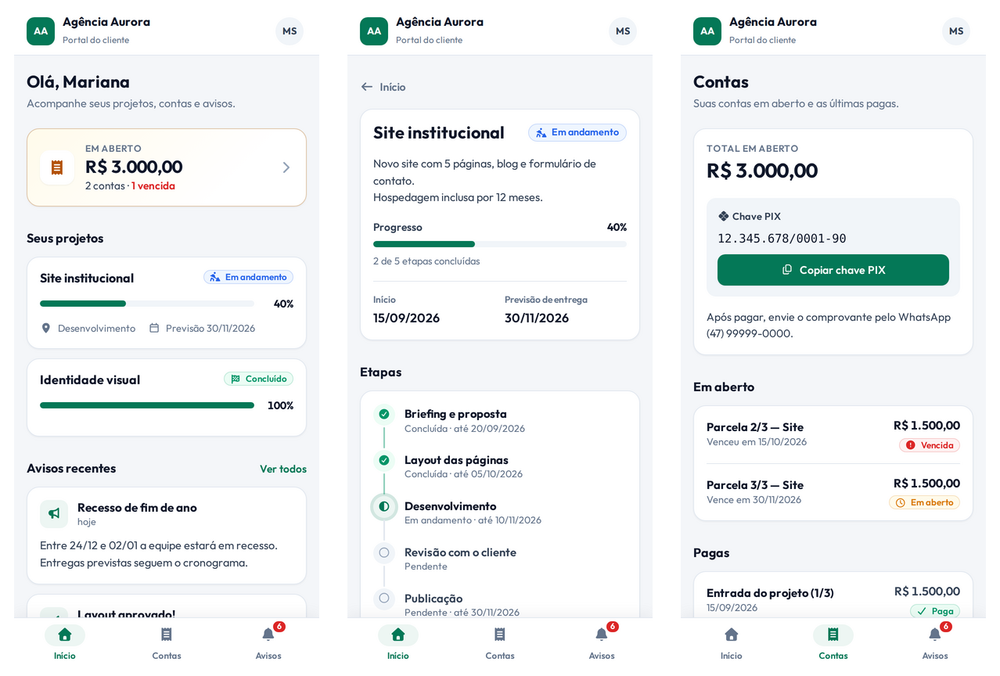
</div>

## 🧱 Arquitetura

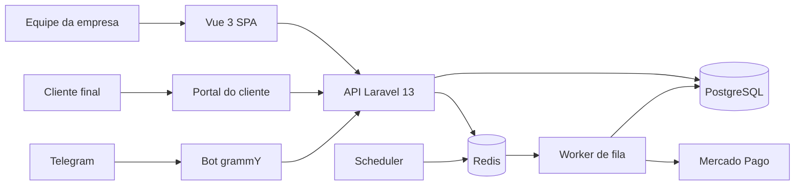

| Camada | Tecnologia |
|---|---|
| API | Laravel 13, PHP 8.3, autenticação por bearer token próprio, auditoria com `spatie/laravel-activitylog` |
| Front | Vue 3 + Vite, Pinia, AG Grid, ECharts, SweetAlert2 |
| Dados | PostgreSQL, Redis (cache, sessão e fila) |
| Assíncrono | Jobs em fila (importações, sincronização do Mercado Pago) e scheduler |
| Bot | Node + TypeScript (grammY), fala só com `/api/bot/*` |
| Infra | Docker Compose: backend, frontend, bot, queue, scheduler, postgres, redis |

### Decisões técnicas que valem a conversa

- **Isolamento entre empresas por padrão.** Um *global scope* filtra toda consulta pela empresa atual, e um teste
  (`TenancyTest`) falha se alguma tabela de modelo nascer sem `company_id`.
- **Permissões como código.** Cada ação do controller declara a permissão com um atributo PHP
  (`#[Permission('users.create')]`), e `config/permissions.php` é a fonte única, sincronizada com o banco.
- **Importação genérica.** Um `ImportService` serve qualquer tipo; clientes e usuários são só *definições*
  (campos, regras, como achar o registro existente, como salvar). Linhas vão para a fila em lotes de 100, e o
  andamento vem da contagem das próprias linhas, sem estado duplicado.
- **Segredos fora dos dados.** Senhas de uma importação de usuários ficam criptografadas à parte, nunca voltam na API e
  são apagadas depois de processadas.
- **Colunas sensíveis protegidas no model.** O atributo `#[ProtectedColumns]` esconde token e afins de toda resposta, ignora
  esses campos em `fill()`/`create()`, tira do log de auditoria e, nos "travados", só deixa o banco ou o console alterar.
- **Testes.** Mais de 170 testes de backend (banco em memória, nunca toca o de desenvolvimento), mais testes de regras do
  front e do parser do bot.

## 🚀 Rodando localmente

```bash
cp .env.example .env
docker compose up -d --build
```

Frontend em http://localhost:5174 e API em http://localhost:8000. Migrations, permissões e usuários de teste são
criados na primeira subida (logins em [Seed / usuário de teste](#seed--usuário-de-teste)).

## 🗺️ Próximos passos

- Escolher um **nicho** e adaptar vocabulário, campos e fluxos a ele.
- Cobranças, boletos e assinaturas pelo Mercado Pago (planejado em [`mercadopago.md`](mercadopago.md)).

## 👤 Autor

**Igor Fronza**, engenheiro de software. [GitHub](https://github.com/PirataZang)

---

# 📚 Documentação técnica

Veja [`design.md`](design.md) para os padrões de componente, página e backend a seguir ao adicionar novas
telas/recursos, e [`mercadopago.md`](mercadopago.md) para o planejamento do módulo de cobranças.

## Subindo o projeto

```bash
cp .env.example .env      # ajuste as portas/senha se quiser
docker compose up -d --build
```

O `entrypoint.sh` do backend instala as dependências do Composer, cria o `.env` do Laravel,
espera o Postgres ficar disponível, gera a `APP_KEY` e roda as migrations automaticamente na
primeira subida.

- Frontend: http://localhost:5174 (porta configurável via `FRONTEND_PORT`)
- Backend/API: http://localhost:8000 (porta configurável via `BACKEND_PORT`)
- Postgres: porta configurável via `DB_PORT_EXTERNAL`; Redis: via `REDIS_PORT_EXTERNAL`

Serviços do `docker-compose.yml`:

| Serviço | Para quê |
|---|---|
| `backend` | API Laravel (migrations e permissões rodam na subida) |
| `frontend` | SPA Vue (Vite) |
| `bot` | Bot do Telegram |
| `scheduler` | `schedule:work`: só **agenda** (sincronização a cada 30 min e pedido de relatório às 8h, 15h e 20h) |
| `queue` | `queue:work`: executa os jobs enfileirados (`backend/app/Jobs`); reinicia a cada hora para pegar deploy |
| `postgres`, `redis` | Banco, cache e fila |

Jobs que falharem ficam na tabela `failed_jobs` (`docker compose exec backend php artisan queue:failed`). Sem o
`queue` rodando, nada sincroniza. Para depurar uma sincronização sem a fila:
`docker compose exec backend php artisan integrations:sync --now`.

## Rota da API (local x VPS)

Todas as chamadas do front usam **uma** variável do `.env` da raiz:

```env
VITE_API_URL=http://localhost:8000/api   # local: backend direto (padrão)
VITE_API_URL=/peppercore-admin/api       # VPS: rota configurada no Nginx
```

O backend sempre serve em `/api`; na VPS o Nginx troca o prefixo. Depois de alterar,
`docker compose up -d frontend`. Exemplo de Nginx na VPS:

```nginx
location /peppercore-admin/api/ {
    proxy_pass http://127.0.0.1:8000/api/;   # a barra final troca /peppercore-admin/api/ por /api/
    proxy_set_header X-Forwarded-For $proxy_add_x_forwarded_for;
    proxy_set_header X-Forwarded-Proto $scheme;
}
location / {
    proxy_pass http://127.0.0.1:5174;
}
```

## Instalando as dependências do frontend

O container do frontend roda `npm install` sozinho na build da imagem. Se preferir rodar fora
do Docker durante o desenvolvimento:

```bash
cd frontend && npm install && npm run dev
```

## Seed / usuário de teste

```bash
docker compose exec backend php artisan db:seed
```

Roda automaticamente a cada subida do container (sincroniza as permissões e cria os usuários só se não
existirem). Logins:

- **Master** (acesso total a todas as empresas, área Restrita): `test@example.com` / `1234` — Empresa Padrão
- **Usuário comum** da "Empresa Exemplo" (clientes + dashboard): `exemplo@example.com` / `1234`

## Multi-empresa (SaaS)

Todo registro pertence a uma empresa; a **Empresa Padrão** (id 1) sempre existe e não pode ser excluída.
Masters trocam de empresa no topo da tela (à esquerda do perfil) e gerenciam empresas em **Restrita › Empresas** (dados,
licença com data de expiração e token). Empresa sem token ou vencida bloqueia os usuários dela na hora.
Masters só são criados/alterados direto no banco:

```bash
docker compose exec postgres psql -U <db_user> -d <db_name> -c "UPDATE users SET master = true WHERE email = 'fulano@x.com'"
```

Formulário público de clientes: `POST /api/public/{token-da-empresa}/customers`. Regras e padrões em
`design.md` (seção 12).

## Portal do cliente

Acesso dos **clientes** da empresa (celular primeiro), só leitura: projetos com etapas e progresso, contas
(receitas pendentes vinculadas ao cliente, com a chave PIX da empresa) e avisos. O link sai em
**Configurações › Portal do cliente** (`/portal/<slug>/entrar`). O cliente informa o e-mail do cadastro e recebe
um código de 6 dígitos por e-mail — configure o SMTP (`MAIL_*` no `backend/.env`); em dev, com
`MAIL_MAILER=log`, o código aparece em `backend/storage/logs/laravel.log`. Projetos e avisos ficam no menu
**Portal do cliente**; para virar conta no portal, a receita precisa ter o campo **Cliente**. Detalhes em
`design.md` (seção 16).

## Integrações (Mercado Pago)

Opcional: em **Configurações › Integrações** cada empresa cola o **Access Token** da própria conta do Mercado Pago
(Developers › sua aplicação › Credenciais de produção). O dinheiro continua na conta de cada empresa; o sistema só
monitora. A cada 30 minutos ele importa vendas e recebimentos (Pix, cartão, boleto), compras feitas pela conta,
tarifas e estornos para o financeiro, com um painel próprio no Dashboard Financeiro. Não há nada para configurar no
`.env`; basta o `scheduler` e o `queue` estarem de pé.

**Pix e transferências enviados** são opcionais (interruptor em **Editar** no card): o Mercado Pago só os entrega
por um relatório da conta, que o sistema pede às 8h, 15h e 20h (Brasília) e no botão **Sincronizar agora**, e lê
cerca de 90 segundos depois. Cada pedido gera um aviso "foi gerado um relatório" no Mercado Pago, e o relatório
demora para listar movimentos recentes (de 20 a 90 minutos). Desligado, nenhum relatório é pedido.

O token fica criptografado com o `APP_KEY` do `backend/.env` — não troque essa chave depois de conectar.
Detalhes em `design.md` (seção 17). O próximo passo (cobranças, boletos e assinaturas) está planejado em
[`mercadopago.md`](mercadopago.md).

## Documentos

Em **Documentos**, templates (contratos, propostas...) escritos num editor de folha A4 com variáveis como
`{{Cliente.name}}`, `{{Projeto.due_date}}`, `{{Empresa.document}}` e `{{Valor}}`. Em **Emitir**, o usuário escolhe
o documento, o cliente, o projeto e o valor, e baixa o PDF já preenchido. Permissões `documents.*`. Detalhes em
`design.md` (seção 18).

## Bot do Telegram

Container `bot` (pasta `bot/`, Node + TypeScript). No `.env` da raiz:

```env
TELEGRAM_BOT_TOKEN=          # do @BotFather
TELEGRAM_BOT_ID=             # número antes do ':' no token (checagem de sanidade)
TELEGRAM_BOT_USERNAME=       # @username do bot, sem @ (monta o link de vínculo)
BOT_API_TOKEN=               # segredo bot↔backend: openssl rand -hex 32
```

`docker compose up -d --build bot backend`. O bot é um só para todas as empresas: cada empresa gera o **seu
código de vínculo** em **Configurações › Telegram** (gerar, gerar novo, revogar) e passa o link
`t.me/<bot>?start=<código>` — abrir o link vincula o Telegram à empresa com um toque (ou mande o código ao bot).
Na mesma aba ficam as contas vinculadas (revogar, reativar, remover). Depois do vínculo o bot abre o menu
**Novo lançamento / Consultar**. Tudo acontece num **cartão
único** que o bot edita a cada etapa (suas respostas digitadas são apagadas para o chat ficar limpo):
- **Novo lançamento**: Receita/Despesa → valor → descrição → categoria → confirmar (com "← Voltar" em cada
  etapa). Fica no chat só o comprovante, e a transação aparece em **Financeiro > Transações** com origem Telegram.
- **Consultar**: escolha o período (este mês, mês passado, este ano, todo o período) e receba o balancete —
  receitas e despesas por categoria, total arrecadado, total gasto, resultado líquido e saldo acumulado.
- `/cancelar` descarta o lançamento em andamento.
- **Desconectar** (`/desconectar`, no botão de menu de comandos do Telegram): desvincula o Telegram da empresa e o bot volta a pedir um
  código — para trocar de empresa ou reconectar com um código novo.

Revogar um usuário:
`docker compose exec backend php artisan tinker --execute='App\Models\TelegramAccount::where("telegram_user_id", ID)->update(["revoked_at" => now()]);'`

Desenvolvimento fora do Docker (pare o container `bot` antes — o Telegram só aceita um polling por token): `cd bot && npm install && BACKEND_URL=http://localhost:8001/api npm run dev`.

## Rate limiting / proxy

Limites por IP em `backend/config/rate-limit.php` (ajustáveis por `RATE_LIMIT_*` no `.env` do backend).
Atrás de Nginx/Docker o IP real vem do `X-Forwarded-For` de proxies confiáveis (`TRUSTED_PROXIES`, padrão
redes privadas). Na VPS, publique o backend só para o Nginx: `"127.0.0.1:${BACKEND_PORT:-8000}:8000"`.

## Log de commits

Antes de commitar, descreva o que foi feito em `.harness/commit-notes.md` (opcional, 2–5 linhas). O hook
`pre-commit` gera `.harness/commits/<branch>_<dd_mm_yyyy>_<HH-MM-SS>.json` — arquivos alterados, linhas,
autor, branch, essas notas e, fora da `main`, os commits anteriores da branch — e o inclui **no mesmo commit**.
Hooks versionados em `.githooks/`; num clone novo, ative uma vez: `git config core.hooksPath .githooks`.
(Skill: `.claude/skills/harness-creator`.)

## Testes

```bash
docker compose exec backend php artisan test   # sqlite em memória, nunca toca o banco de dev
cd frontend && npm test                          # regras de permissão/menu/busca/períodos (node --test)
cd bot && npm test                               # parser de valores do bot (node --test)
```

## Estrutura

```
backend/    Laravel 13 — API, auth por bearer token custom (AuthMiddleware/AuthService),
            auditoria via spatie/laravel-activitylog, Redis (cache/sessão/fila), jobs em app/Jobs
frontend/   Vue 3 + Vite — SPA (login, dashboards com ECharts, usuários, clientes, financeiro, integrações)
bot/        Node + TypeScript — bot do Telegram (grammY); fala só com /api/bot/* do backend
```

Componentes reutilizáveis inclusos: `Input`, `TextArea`, `Switch`, `Button`, `AgGrid`, `Modal`,
`EChart`, `PageHeader`, `FormActions`, `ActivityLogModal`. Telas: `Login`, `Dashboard` e um CRUD
completo de `Usuários` (com botão "Histórico" mostrando o log de alterações). Para adicionar uma
tela nova, siga o padrão descrito em `design.md`.
